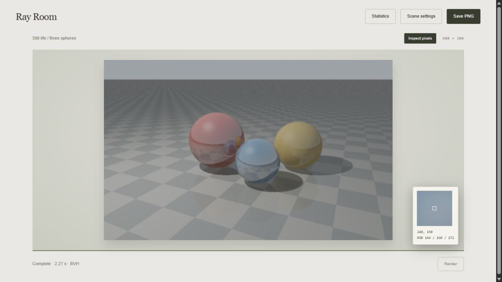

# Ray Room

A dependency-free CPU ray-tracing studio. Compose a still life or a 48-sphere field, adjust camera and light, and watch worker-rendered tiles become an image.



## Run

Requires Python 3.10+ to serve the files and a modern browser supporting module Web Workers.

```sh
python run.py
```

Open http://127.0.0.1:8000/. Use `--port 8828` for another port. Rendering stays in the browser; the server exposes only five static assets on loopback. No installation, account, GPU, or external assets required.

## Interface

The rendered image occupies the main viewer with a compact toolbar and progress indicator. Scene settings open in a bottom dialog and close when rendering starts. Statistics open separately. Portrait and landscape images preserve their aspect ratio as the viewport changes; exports retain the selected pixel resolution. Cancel remains beside the viewer during rendering.

**Inspect pixels** opens a nine-by-nine pixel loupe with zero-based image coordinates and final 8-bit RGB values. Move over the image or focus it and use arrow keys. Inspection is available only for a completed render and is cleared when settings change or rendering is cancelled. The magnifier stays outside the exported image.

## Explore

- Orbit the camera, move the point light, and tune reflection strength and depth.
- Choose 1, 4, or 16 deterministic stratified samples per pixel. Resolution is bounded to 640 × 480 and recursion to three reflection bounces.
- Compare median-split bounding-volume hierarchy traversal against brute force. Pixel output is identical; intersection counters reveal the work saved, particularly in the sphere field.
- Inspect surface normals without shading or secondary rays.
- Cancel immediately or change settings to terminate the worker. An incomplete or stale frame cannot be exported as a completed PNG/report.
- Export/import validated scene JSON, save completed PNGs, and download render reports containing configuration, timing, and ray/intersection counters.

Settings changes require an explicit new render. Failed imports preserve the current configuration. Scene JSON contains only renderer settings, not image data.

## Implementation

`core.js` contains sphere quadratics, parallel-safe slab intersections, a median-split BVH, an orbit camera, checker floor, hard point-light shadows, Blinn–Phong highlights, and recursive mirror reflections. Fixed subpixel grids make tiled and full-frame rendering byte-identical. Beauty output uses Reinhard tone mapping and gamma 2.2; normal output maps signed components directly to RGB.

`worker.js` transfers eight-row pixel buffers to the main thread. `app.js` owns cancellation and revision checks, canvas presentation, and downloads. `run.py` serves an explicit asset allowlist with security headers. The renderer reports primary, traced, and shadow rays separately; traced rays include primary rays and recursive reflections, while shadow queries have their own count. BVH node count describes the built tree even when traversal is disabled.

This is an educational Whitted-style renderer, not a physically based path tracer. It has no global illumination, area lights, refraction, mesh loading, or adaptive antialiasing. The fixed epsilon suits these bounded example scenes and is not a general robust floating-point error bound. Rendering time depends on the browser and CPU.

## Verify

Requires Node.js 22+ for core tests; no npm dependencies are needed.

```sh
node --test
npm run check
python -m unittest discover -s tests -v
```

Nine JavaScript tests cover near/far/tangent/inside sphere intersections, parallel slab rays, reflection geometry, 3,000 generated BVH/brute-force ray comparisons, degenerate bounds, camera bases, exact tile stitching, byte-identical acceleration modes, and configuration limits. The render comparison also asserts reduced sphere tests. A Python HTTP test verifies the worker asset, path allowlist, Host rejection, and HEAD behavior. GitHub Actions runs on Linux and Windows.

Browser checks cover completed rendering, PNG dimensions, cancellation, stale export disabling, and surface-normal diagnostics.

## References

- [PBRT: Bounding Volume Hierarchies](https://www.pbr-book.org/4ed/Primitives_and_Intersection_Acceleration/Bounding_Volume_Hierarchies)
- [PBRT: Managing Rounding Error](https://www.pbr-book.org/4ed/Shapes/Managing_Rounding_Error)

An independent computer graphics portfolio project with implementation commits and reproducible tests.
